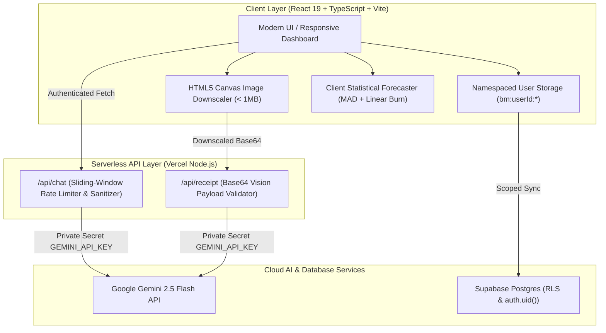

# CODEFESTTHON 2026 Submission Package — BudgetMitra

**Project:** BudgetMitra — AI Financial Intelligence & Executive Hub for Students  
**Track:** AI/ML  
**Repository:** [https://github.com/workamannakashe-sudo/BM-Fintech-](https://github.com/workamannakashe-sudo/BM-Fintech-)  
**Live Production URL:** [https://ibm-fintech.vercel.app/](https://ibm-fintech.vercel.app/)  
**Prior Work Disclosure:** [DISCLOSURE.md](./DISCLOSURE.md)  

---

## 1. 150-Word Elevator Pitch (Portal Copy)

Over 70% of college students exhaust their monthly allowances within the first two weeks due to unpredictable burn rates and hidden expenses. BudgetMitra is a student-first AI financial co-pilot built to eliminate financial stress before it happens.

Powered by a dual-engine architecture combining Google Gemini 2.5 Flash and statistical machine learning (Modified Z-Score with Median Absolute Deviation), BudgetMitra accurately flags spending anomalies, forecasts the exact day an allowance will run out, and suggests precise daily reductions to maintain solvency. It features Gemini Vision for camera receipt ingestion with client-side canvas downscaling, zero-loss group expense splitting with 1-tap UPI and WhatsApp deep-links, and an empathetic multi-turn AI assistant grounded strictly in live user metrics.

With strict user data isolation, Row Level Security, offline heuristic fallbacks, and 111 automated tests, BudgetMitra delivers enterprise-grade financial intelligence tailored to modern student life.

---

## 2. Architecture Diagram

---

## 3. Two-Minute Video Pitch & Demo Script

| Timecode | Visual Screen | Voiceover Script | Action / Demonstration |
| :--- | :--- | :--- | :--- |
| **0:00 – 0:20** | **Landing & Demo Mode** | "Managing money in college is overwhelming. Most students run out of cash mid-month because they lack burn-rate visibility. Welcome to BudgetMitra — the intelligent financial co-pilot designed specifically for students." | Click "Try Demo Mode" or sign in. Point out the persistent Demo Mode isolation banner. |
| **0:20 – 0:50** | **Dashboard & AI Spend Forecaster** | "On the dashboard, our statistical machine learning engine calculates daily velocity using Boris Iglewicz Modified Z-Scores. Notice the month-end trajectory banner: it predicts whether your allowance will last, showing the exact date it runs out and the daily reduction needed to stay on track." | Highlight the AI Month-End Trajectory card showing daily burn rate and projected savings. |
| **0:50 – 1:15** | **AI Vision Receipt Scanner** | "Logging expenses shouldn't be manual. With our Gemini Vision receipt scanner, simply take a photo of any receipt. Client-side canvas compression downscales the image instantly, and Gemini 2.5 Flash extracts merchant name, date, total, and line items into an editable confirmation modal." | Click "Scan Receipt (AI Vision)", upload a bill photo, review extracted items, and click "Save to Expenses". |
| **1:15 – 1:40** | **Group Bill Splitting & Deep-Links** | "Splitting group bills is effortless. Our zero-loss algorithm allocates any non-divisible cent or paisa remainder to the payer. Students can add custom friends, generate compliant UPI payment QR codes, and share instant 1-tap WhatsApp payment requests." | Open Split Bill, add a custom friend, show zero-loss equal shares, and click WhatsApp share / UPI QR. |
| **1:40 – 2:00** | **Grounded FinBuddy Assistant & Security** | "Our FinBuddy assistant is grounded strictly in real user metrics — never fake demo data — with built-in student safety guardrails. With 111 automated passing tests, Supabase Row Level Security, and offline heuristics, BudgetMitra is production-ready." | Open Ask FinBuddy, demonstrate live grounded badge, ask 'Can I afford pizza tonight?', show verdict. |

---

## 4. Screenshot Checklist for Hackathon Portal

* [x] **01_dashboard_forecast.png**: Main dashboard showing AI Month-End Spending Forecast, daily burn velocity, and quick action pills.
* [x] **02_receipt_scanner.png**: AI Vision Receipt Scanner modal with document preview, extracted merchant, total, and line items.
* [x] **03_split_bill_upi.png**: Split Bill interface with zero-loss division, custom friend cards, and UPI QR code generator.
* [x] **04_finbuddy_grounded.png**: FinBuddy chat drawer highlighting the green "Grounded on: last 30 days" badge and conversational reasoning.
* [x] **05_onboarding_wizard.png**: 4-step first-time setup wizard configuring course, allowance, budget envelopes, and goals.
* [x] **06_test_suite_passing.png**: Terminal output showing 111 passing tests across 24 test suites.

---

## 5. Verification & Live Links

* **Live Demo:** [https://ibm-fintech.vercel.app/](https://ibm-fintech.vercel.app/)
* **GitHub Repository:** [https://github.com/workamannakashe-sudo/BM-Fintech-](https://github.com/workamannakashe-sudo/BM-Fintech-)
* **Prior Work Disclosure:** [DISCLOSURE.md](./DISCLOSURE.md)
* **Automated Test Suite:** 111 passing unit/integration tests across 24 suites (`npm run verify`).
